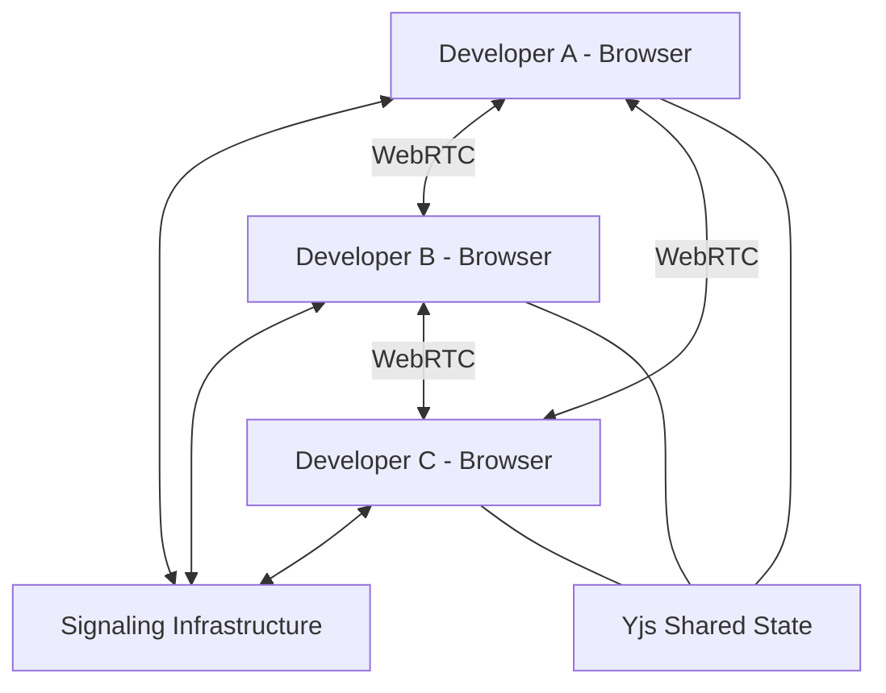

# FORGE
### A peer-to-peer collaborative coding workspace.

**Code together. Share context. Build without a centralized workspace server.**

[**Live Demo**](https://forge-p2p.vercel.app/) · [Report a Bug](https://github.com/milensebastian/FORGE/issues)

---

## Overview

FORGE is an experimental peer-to-peer collaborative development environment designed to explore a different approach to working together on code.

Instead of relying entirely on a centralized server to coordinate every interaction, FORGE explores browser-based peer-to-peer communication to connect collaborators and synchronize their workspace.

The goal is simple:

**Make collaborative development feel like working on the same machine, even when collaborators are physically apart.**

FORGE combines real-time collaboration concepts, browser-based development tools and distributed communication technologies into one workspace.

## The Idea

Traditional collaborative development often depends on a combination of:

- Remote development environments
- Centralized collaboration services
- Git-based synchronization
- Separate communication tools

FORGE explores a more direct approach: connecting participants and sharing workspace state through peer-to-peer communication.

## Core Technologies

| Technology | Purpose |
|---|---|
| React | User interface |
| TypeScript | Type-safe development |
| Vite | Development and build tooling |
| WebRTC | Peer-to-peer communication |
| Yjs | Collaborative shared-state synchronization |
| y-webrtc | WebRTC-based Yjs provider |

*Technology descriptions reflect the project's intended technical architecture; individual integrations should be verified against the current implementation.*

## Architecture



### How it works

1. **Discovery:** Participants use signaling infrastructure to discover and establish connections.
2. **Connection:** WebRTC negotiates direct communication between browsers.
3. **Synchronization:** Shared workspace data can be synchronized using Yjs.
4. **Collaboration:** Connected participants can work with shared state without routing every update through a central application server.

A signaling server is still needed for connection establishment. STUN and TURN infrastructure may also be needed depending on network conditions.

## Why FORGE?

- **Peer-to-peer first:** Explore direct communication between collaborators.
- **Real-time synchronization:** Investigate conflict-free collaborative state using CRDT technology.
- **Browser-based:** Reduce the need for heavyweight local setup.
- **Distributed systems:** Explore the engineering challenges of coordinating multiple independent clients.

## Engineering Challenges

FORGE is also an exploration of several interesting computer science problems:

- Peer discovery and connection negotiation
- NAT traversal and relay infrastructure
- Distributed state synchronization
- Concurrent editing and conflict resolution
- Network reliability and reconnection
- Multi-user resource management
- Security and access control

These challenges make FORGE more than a UI experiment.

## Running Locally

### Prerequisites

- Node.js
- npm
- Git

### Installation

```bash
git clone https://github.com/milensebastian/FORGE.git

cd FORGE

npm install

npm run dev
```

Open the local URL provided by Vite.

*Adjust the repository URL and commands if your actual repository name or package scripts differ.*

## Project Status

FORGE is an experimental project under active development.

The project explores the feasibility of a browser-based, peer-to-peer collaborative development environment.

Features, architecture and infrastructure may evolve as development continues.

## Security Considerations

Peer-to-peer communication introduces its own security challenges.

Important areas include:

- Authentication and participant authorization
- Secure signaling
- Peer connection validation
- Transport encryption
- Shared workspace access control
- Protection against unauthorized collaboration sessions

WebRTC provides encrypted transport, but that alone does not guarantee application-level authorization or end-to-end security across every part of the system.

## Author

**Milen Sebastian**

Cybersecurity Undergraduate · Developer · Builder

- Portfolio: https://milen.vercel.app/
- GitHub: https://github.com/milensebastian
- LinkedIn: https://www.linkedin.com/in/milensebastian/

---

<div align="center">

**FORGE**

*Build together. Think independently.*

</div>
